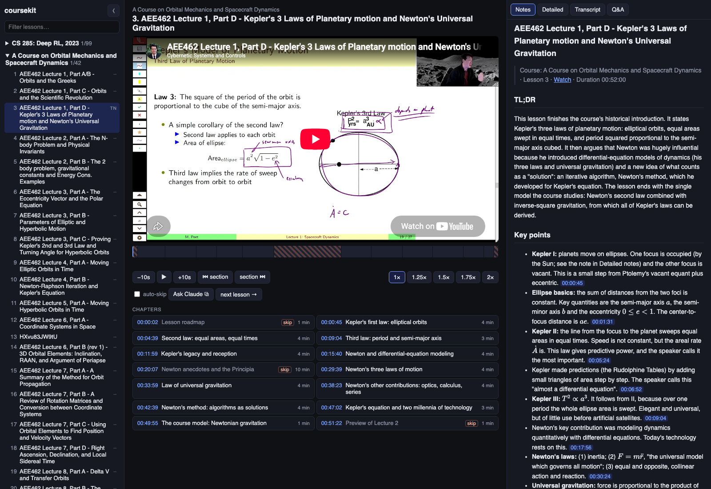

# coursekit

A local companion for learning from YouTube courses with Claude.

- **Ingest** any playlist or video (public or unlisted), given its URL.
- **Transcribe**: uses YouTube subtitles when they exist, and runs local Whisper otherwise (`mlx-whisper` on Apple Silicon, `faster-whisper` elsewhere).
- **Write notes** for every lesson with Claude: a TL;DR, **chapters** that mark skippable filler, short **key points**, separate **detailed notes**, key terms and review questions. Profiles add extras: verified hadith and Quran references, code examples, equations, and so on.
- **Watch** in a focused local player: a chapter bar and list under the video, speed controls, ±10s, jump by chapter, **auto-skip** filler, a synced clickable transcript, Notes and Detailed tabs with clickable timestamps, and resume position.
- **Ask Claude on the side**: an MCP server lets the Claude app or Claude Code see *what you're watching right now*, read the transcript around that moment, search the whole library, move the player, and save answers, references and code back next to the lesson.

Everything is stored as plain markdown, so any agent can use it as context.



## Install

Requires [uv](https://docs.astral.sh/uv/), `ffmpeg`, and [Claude Code](https://claude.com/claude-code) (`claude` on your PATH, used headlessly to write the notes; no API key needed).

```bash
git clone https://github.com/anonx3247/coursekit && cd coursekit
uv sync
uv run ck --help            # or: uv tool install -e . && ck --help
```

## Use

```bash
# 1. Register courses (metadata only; fast)
ck add "https://www.youtube.com/playlist?list=PL_iWQOsE6TfVYGEGiAOMaOzzv41Jfm_Ps" --slug cs285-deep-rl --profile ml   --language en
ck add "https://www.youtube.com/playlist?list=PL5ebyVGQORm6IUCJIuXGYj21o91Uyrwc4" --slug orbital-mechanics --profile stem --language en
ck add "<unlisted playlist url>" --profile islamic --language fr --whisper-prompt "isnad, matn, sahih, Bukhari, Muslim…"

# 2. Transcribe + write notes (idempotent: skips what exists; lesson ranges allowed)
ck process cs285-deep-rl            # whole course
ck process orbital-mechanics 1-5    # some lessons
ck process --notes-only --force-notes cs285-deep-rl 3   # regenerate notes

# 3. Watch
ck open cs285-deep-rl 1             # starts the player on http://localhost:8765
ck list -v                          # status per lesson (T = transcript, N = notes)
```

Player keys: `space`/`k` play · `←`/`→` (`j`/`l`) ±10s · `s` next section · `p` previous section · `<` `>` speed · `a` auto-skip · `n` next lesson · `c` copy "where I am" for Claude · `t` transcript · `b` sidebar.

### Profiles

The notes prompt is the base template plus a profile (`ck profiles`):

| profile | adds |
|---|---|
| `default` | resources mentioned |
| `islamic` | every hadith / verse / athar cited, **checked with web search** (collection + number, grading, sunnah.com / quran.com links, confidence), scholars, Arabic terminology |
| `ml` | key equations (LaTeX), runnable PyTorch / Gymnasium examples, papers |
| `stem` | equations, derivations, a numerical Python example, history |

Add your own in `library/profiles/<name>.md` (same format as [`src/coursekit/profiles`](src/coursekit/profiles)). Per-course tweaks:
`ck set <course> notes_language French`, `ck set <course> notes_instructions "…"`, `ck set <course> force_whisper true`.

## Use with Claude

Register the MCP server (stdio):

```bash
# Claude Code
claude mcp add --scope user coursekit -- uv run --directory /path/to/coursekit ck mcp
```

```jsonc
// Claude desktop app: ~/Library/Application Support/Claude/claude_desktop_config.json
{ "mcpServers": { "coursekit": { "command": "uv", "args": ["run", "--directory", "/path/to/coursekit", "ck", "mcp"] } } }
```

Then, with the player open, ask things like:

- *"What does he mean here?"*: Claude calls `now_playing` and gets the lesson, position, current section and the transcript around it.
- *"Find the sources for the hadiths in the last 5 minutes."* (or use the **find_references** prompt): Claude verifies them and saves them with `save_annotation`. They appear in the player's Q&A tab.
- *"Show me code for this algorithm"* (**code_example** prompt).
- *"Where in the course does he derive the vis-viva equation? Take me there."*: `search` + `seek`.

| tool | what it does |
|---|---|
| `now_playing` | current course / lesson / time / section + nearby transcript |
| `list_courses`, `get_course`, `get_notes`, `get_transcript` | read the library |
| `search` | regex search across transcripts, notes, annotations (with timestamped links) |
| `seek`, `player_control`, `open_player` | drive the player (open lesson at a time, speed, play/pause, skip section) |
| `save_annotation` | append Q&A, references, code to the lesson (`annotations.md`) |
| `add_course`, `process_lesson` | ingest from chat |

The MCP server starts the web player automatically if it isn't running.

### Skill

[`skills/coursekit/SKILL.md`](skills/coursekit/SKILL.md) teaches Claude how to study with you. It grounds every answer in `now_playing`, verifies references before saving them, writes code for ML lectures, quizzes you from the key points, and so on.

```bash
ln -s "$PWD/skills/coursekit" ~/.claude/skills/coursekit       # Claude Code
cd skills && zip -r ../coursekit-skill.zip coursekit           # Claude app: Settings → Capabilities → Skills → upload
```

## Library layout

```
library/                              # COURSEKIT_LIBRARY to relocate; gitignored
  CLAUDE.md                           # explains this layout to agents
  cs285-deep-rl/
    course.json   README.md           # metadata, generated index with per-lesson TL;DRs
    lessons/001-cs-285-lecture-1-introduction-part-1/
      transcript.md                   # **[00:01:28](youtube link&t=88s)** paragraph…
      transcript.json                 # segments for the player
      notes.md                        # TL;DR, ## Outline (- [hh:mm:ss] Title {skip: reason}), notes…
      annotations.md                  # added later by Claude
  .state/                             # now_playing.json, progress.json, logs
```

You can also just `cd library && claude`: the `CLAUDE.md` there explains the structure.

See [`examples/`](examples) for real output from CS 285 (Deep RL) and the orbital mechanics course.

## Configuration

| env var | default |
|---|---|
| `COURSEKIT_LIBRARY` | `./library` |
| `COURSEKIT_PORT` | `8765` |
| `COURSEKIT_WHISPER_MODEL` | `mlx-community/whisper-large-v3-turbo` |
| `COURSEKIT_NOTES_MODEL` | your Claude Code default |
| `COURSEKIT_COOKIES_FROM_BROWSER` | unset. Set to `chrome` / `firefox` / `safari` for private or members-only videos |

Unlisted videos work from their URL without cookies. Only add courses you have the right to access.
